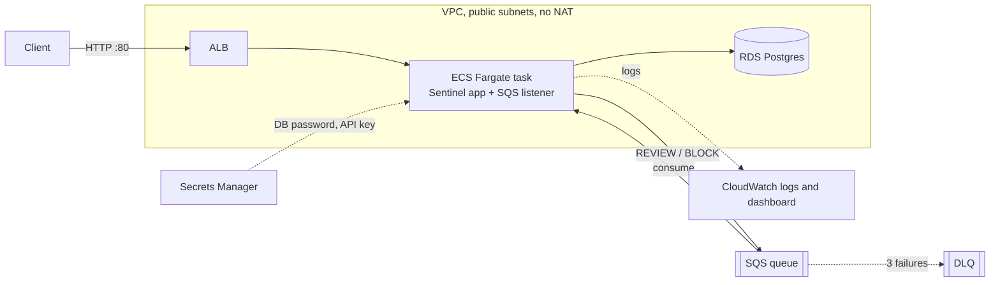

# Sentinel

[](https://github.com/mini4141/vie-sentinel/actions/workflows/ci.yml)

Sentinel is a small real-time fraud decision service (Kotlin, Spring Boot 3, Postgres) built to show the whole delivery path of a JVM backend: containers, async messaging, CI, Terraform, and an ephemeral AWS deployment with proven teardown. The business logic is deliberately tiny (three rules, one scoring engine); the point is that every piece of the stack works end to end and is reproducible.

## Architecture



## Tech showcase

| # | Skill | Evidence |
|---|---|---|
| 1 | Kotlin + Spring Boot 3 | [app/](app/) |
| 2 | Postgres + Flyway | [V1__init.sql](app/src/main/resources/db/migration/V1__init.sql), [repositories](app/src/main/kotlin/dev/sentinel/persistence/Repositories.kt) |
| 3 | SQS with DLQ, same code on LocalStack and AWS | [Alerts.kt](app/src/main/kotlin/dev/sentinel/queue/Alerts.kt), [init script](localstack/init/init-sqs.sh), [sqs module](infra/modules/sqs/main.tf) |
| 4 | Docker | [Dockerfile](app/Dockerfile) (multi-stage, non-root, healthcheck), [docker-compose.yml](docker-compose.yml) |
| 5 | CI (GitHub Actions) | [ci.yml](.github/workflows/ci.yml): terraform fmt/validate, detekt, tests, image build, compose smoke test |
| 6 | Terraform, modular, remote state | [infra/](infra/), [plan on PR](.github/workflows/terraform-plan.yml) |
| 7 | AWS: VPC, ALB, ECS Fargate, RDS, SQS, ECR, Secrets Manager, CloudWatch, SNS | [plan summary](docs/terraform-plan-demo.txt), [apply log](docs/proof/terraform-apply.txt) |
| 8 | GitHub OIDC (no static keys) | [oidc module](infra/modules/oidc/main.tf) (CD workflows: see status below) |
| 9 | Observability | JSON logs, Micrometer `/actuator/prometheus`, [dashboard and 2 alarms](infra/modules/monitoring/main.tf) |
| 10 | Cost discipline | ephemeral stack, [kill timer](scripts/kill-timer.ps1), [teardown check](docs/proof/verify-teardown.txt) |
| 11 | AI-assisted workflow | [CLAUDE.md](CLAUDE.md), [AI_WORKFLOW.md](docs/AI_WORKFLOW.md) |

## Run locally (3 commands)

```bash
docker compose up --build -d
API_KEY=dev-api-key scripts/smoke-test.sh http://localhost:8080
docker compose down -v
```

Unit and integration tests (the integration test needs Docker): `cd app && ./gradlew detekt test`.

## How the ephemeral deploy works

1. `infra/bootstrap/` (applied once, cheap): state bucket, lock table, ECR repo, GitHub OIDC provider and roles.
2. Build and push the image to ECR.
3. `terraform apply` in `infra/demo/` (VPC, ALB, Fargate, RDS, SQS, monitoring).
4. `scripts/kill-timer.ps1` schedules a destroy at T+90 minutes as a safety net.
5. `scripts/proof-run.ps1` runs the scenarios, the smoke test and a short k6 load test; output goes to [docs/proof/](docs/proof/).
6. `terraform destroy`, then `scripts/verify-teardown.ps1` must report zero leftovers.

Details and failure handling: [runbook](docs/runbook.md). Decisions: [ADR 0001 SQS](docs/adr/0001-why-sqs.md), [0002 Fargate](docs/adr/0002-why-fargate.md), [0003 ephemeral, no NAT](docs/adr/0003-ephemeral-environment-no-nat.md).

## Proof (AWS, ap-southeast-2)

- Smoke test on AWS: PASS, all 8 steps in 21s ([output](docs/proof/smoke-test-aws.txt)).
- ALLOW, REVIEW and BLOCK scenarios: [scenarios-aws.txt](docs/proof/scenarios-aws.txt).
- k6, 30s at 5 VUs: 343 requests, 0% failed, p95 499 ms ([k6-aws.txt](docs/proof/k6-aws.txt)).
- Apply and destroy of 36 resources: [apply](docs/proof/terraform-apply.txt), [destroy](docs/proof/terraform-destroy.txt).
- Teardown verified clean: [verify-teardown.txt](docs/proof/verify-teardown.txt).
- Console screenshots (ECS, RDS, CloudWatch): taken during the session; add them under `docs/proof/screenshots/` after redacting the account ID.

## GCP to AWS mapping

| GCP | AWS (this project) |
|---|---|
| Cloud Run / GKE Autopilot | ECS Fargate |
| Cloud SQL for PostgreSQL | RDS PostgreSQL |
| Pub/Sub (topic, subscription, dead-letter topic) | SQS queue plus DLQ |
| Artifact Registry | ECR |
| Secret Manager | Secrets Manager |
| Cloud Load Balancing | ALB |
| Cloud Logging and Monitoring | CloudWatch logs, dashboards, alarms |
| Alerting notification channel | SNS topic |
| Workload Identity Federation | GitHub OIDC provider and IAM role |
| VPC | VPC (public subnets only) |
| Cloud Build / Cloud Deploy | GitHub Actions |

## Cost

The demo stack is estimated at about $0.11 per hour (Fargate 0.5 vCPU / 1 GB, `db.t4g.micro`, one ALB). The first session ran about 10 minutes in `ap-southeast-2`, so the expected charge is cents. The permanent bootstrap stack (S3, DynamoDB on-demand, ECR with at most 3 images) costs almost nothing. Cost Explorer screenshot: add after charges post (about a day).

## Status

- Phases 1, 2, 4 and 5 are complete and verified. CI (Phase 3) is written; the badge above reflects its real status once GitHub runs it.
- Phase 6 (`deploy.yml`, `destroy.yml` via OIDC) is not built: the Phase 5 manual session is the evidence for the AWS deploy.
