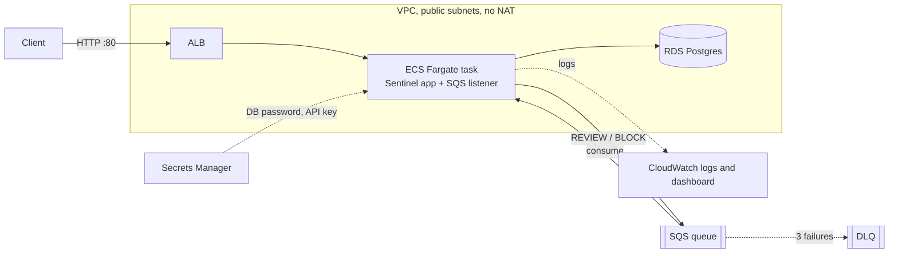

# Sentinel

[](https://github.com/mini4141/vie-sentinel/actions/workflows/ci.yml)

Sentinel is a small real-time fraud decision service (Kotlin, Spring Boot 3, Postgres) built to show the whole delivery path of a JVM backend: containers, async messaging, CI, Terraform, and an ephemeral AWS deployment with proven teardown. The business logic is deliberately tiny (three rules, one scoring engine); the point is that every piece of the stack works end to end and is reproducible.

## Architecture



## Tech showcase

| # | Skill | Evidence |
|---|---|---|
| 1 | Kotlin + Spring Boot 3 | [app/](app/) |
| 2 | Postgres + Flyway | [V1__init.sql](app/src/main/resources/db/migration/V1__init.sql), [repositories](app/src/main/kotlin/dev/sentinel/persistence/Repositories.kt) |
| 3 | SQS with DLQ, same code on LocalStack and AWS | [Alerts.kt](app/src/main/kotlin/dev/sentinel/queue/Alerts.kt), [init script](localstack/init/init-sqs.sh), [sqs module](infra/modules/sqs/main.tf) |
| 4 | Docker | [Dockerfile](app/Dockerfile) (multi-stage, non-root, healthcheck), [docker-compose.yml](docker-compose.yml) |
| 5 | CI (GitHub Actions) | [ci.yml](.github/workflows/ci.yml): terraform fmt/validate, detekt, tests, image build, compose smoke test |
| 6 | Terraform, modular, remote state | [infra/](infra/); `terraform-plan.yml` verified end to end on a PR (closed, not merged), OIDC login, plan posted as a PR comment |
| 7 | AWS: VPC, ALB, ECS Fargate, RDS, SQS, ECR, Secrets Manager, CloudWatch, SNS | Applied manually from a laptop with the same Terraform: [plan summary](docs/terraform-plan-demo.txt), [apply log](docs/proof/terraform-apply.txt), [destroy log](docs/proof/terraform-destroy.txt) |
| 8 | GitHub OIDC (no static keys) and CD | [oidc module](infra/modules/oidc/main.tf), used by the PR plan workflow (verified). CD: [deploy.yml](.github/workflows/deploy.yml) and [destroy.yml](.github/workflows/destroy.yml): one successful run, build, deploy, smoke and destroy all green, [run 45003516072](https://github.com/mini4141/vie-sentinel/actions/runs/45003516072) (OIDC, no stored keys) |
| 9 | Observability | JSON logs, Micrometer `/actuator/prometheus`, [dashboard and 2 alarms](infra/modules/monitoring/main.tf) |
| 10 | Cost discipline | ephemeral stack, [kill timer](scripts/kill-timer.ps1), [teardown check](docs/proof/verify-teardown.txt) |
| 11 | AI-assisted workflow | [CLAUDE.md](CLAUDE.md), [AI_WORKFLOW.md](docs/AI_WORKFLOW.md) |

## Run locally (3 commands)

```bash
docker compose up --build -d
API_KEY=dev-api-key scripts/smoke-test.sh http://localhost:8080
docker compose down -v
```

Unit and integration tests (the integration test needs Docker): `cd app && ./gradlew detekt test`.

## How the ephemeral deploy works

1. `infra/bootstrap/` (applied once, cheap): state bucket, lock table, ECR repo, GitHub OIDC provider and roles.
2. Build and push the image to ECR.
3. `terraform apply` in `infra/demo/` (VPC, ALB, Fargate, RDS, SQS, monitoring).
4. `scripts/kill-timer.ps1` schedules a destroy at T+90 minutes as a safety net.
5. `scripts/proof-run.ps1` runs the scenarios, the smoke test and a short k6 load test; output goes to [docs/proof/](docs/proof/).
6. `terraform destroy`, then `scripts/verify-teardown.ps1` must report zero leftovers.

Details and failure handling: [runbook](docs/runbook.md). Decisions: [ADR 0001 SQS](docs/adr/0001-why-sqs.md), [0002 Fargate](docs/adr/0002-why-fargate.md), [0003 ephemeral, no NAT](docs/adr/0003-ephemeral-environment-no-nat.md).

## Proof (AWS, ap-southeast-2)

- Smoke test on AWS: PASS, all 8 steps in 21s ([output](docs/proof/smoke-test-aws.txt)).
- ALLOW, REVIEW and BLOCK scenarios: [scenarios-aws.txt](docs/proof/scenarios-aws.txt).
- k6, 30s at 5 VUs: 343 requests, 0% failed, p95 499 ms ([k6-aws.txt](docs/proof/k6-aws.txt)).
- Apply and destroy of 36 resources: [apply](docs/proof/terraform-apply.txt), [destroy](docs/proof/terraform-destroy.txt).
- Teardown verified clean: [verify-teardown.txt](docs/proof/verify-teardown.txt).
- GitHub Actions: green CI run, [screenshot](docs/proof/screenshots/actions-green.png).
- Cost Explorer: optional, to be added later once charges post.
- ECS, RDS and CloudWatch console screenshots were skipped; the saved logs above are the evidence.

## CD workflow

`deploy.yml` is `workflow_dispatch` only and must be run from `main`, because the deploy role trusts only the `main` ref of this repository through GitHub OIDC (no stored keys). Jobs run in order:

1. **build**: build the image and push it to ECR, tagged with the commit SHA.
2. **deploy**: `terraform init` (S3 backend, bucket from a repository variable) and `terraform apply` on `infra/demo` with that image tag.
3. **smoke**: wait for the ALB health check, run `scripts/smoke-test.sh` against the ALB URL, write the URL and results to the job summary, and upload the proof files as an artifact.
4. **destroy**: always runs (`if: always()`), even if earlier jobs fail. It runs `terraform destroy`, then `scripts/verify-teardown.sh`, and fails the run if anything is left.

There is no laptop kill timer here: per-job `timeout-minutes` (about 65 minutes in total) and the always-destroy job replace it. A concurrency group allows one deploy at a time. `destroy.yml` is the manual emergency teardown (same destroy and teardown check). `verify-teardown.yml` is a read-only manual check that nothing is left; the same check runs from a laptop with `scripts/verify-teardown.ps1` or `scripts/verify-teardown.sh`.

Repository **secrets** to set (Settings, Secrets and variables, Actions, Secrets). They are secrets, not variables, so GitHub masks them in the public workflow logs; the role ARNs and the state bucket name contain the AWS account ID:

| Secret | Used by | Value |
|---|---|---|
| `TF_STATE_BUCKET` | plan, deploy, destroy | the state bucket name from the bootstrap output `state_bucket` |
| `AWS_PLAN_ROLE_ARN` | `terraform-plan.yml` | the bootstrap output `plan_role_arn` |
| `AWS_DEPLOY_ROLE_ARN` | deploy, destroy | the bootstrap output `deploy_role_arn` |

## GCP to AWS mapping

| GCP | AWS (this project) |
|---|---|
| Cloud Run / GKE Autopilot | ECS Fargate |
| Cloud SQL for PostgreSQL | RDS PostgreSQL |
| Pub/Sub (topic, subscription, dead-letter topic) | SQS queue plus DLQ |
| Artifact Registry | ECR |
| Secret Manager | Secrets Manager |
| Cloud Load Balancing | ALB |
| Cloud Logging and Monitoring | CloudWatch logs, dashboards, alarms |
| Alerting notification channel | SNS topic |
| Workload Identity Federation | GitHub OIDC provider and IAM role |
| VPC | VPC (public subnets only) |
| Cloud Build / Cloud Deploy | GitHub Actions |

## Cost

The demo stack is estimated at about $0.11 per hour (Fargate 0.5 vCPU / 1 GB, `db.t4g.micro`, one ALB). This is an estimate, not a measured figure. There were two AWS sessions, both well under 1 hour: the manual one (about 16 minutes from apply start to destroy complete) and the CD run (the stack existed for about 13 minutes), so the expected total is cents. The permanent bootstrap stack (S3, DynamoDB on-demand, ECR with at most 3 images) costs almost nothing. The actual total will be confirmed in Cost Explorer.

## Status

- CI is green (`ci.yml`, run for `ce738a4`): terraform fmt and validate, detekt, tests, image build, and the compose smoke test.
- `terraform-plan.yml` is verified end to end on a pull request (PR closed, not merged). It logs in to AWS through GitHub OIDC with no stored keys.
- CD is verified: [`deploy.yml` run 45003516072](https://github.com/mini4141/vie-sentinel/actions/runs/45003516072) succeeded end to end from `main` on 2026-11-22 (08:35:20Z to 08:51:03Z, 15 min 43 s). Build 08:35:24Z to 08:37:12Z, deploy 08:37:15Z to 08:43:29Z, smoke 08:43:32Z to 08:44:44Z (PASS, 8 of 8 steps in 10 s), destroy and teardown check 08:44:47Z to 08:51:02Z (clean). The demo stack existed from 08:37:37Z (first resource) to 08:50:41Z (destroy complete), about 13 minutes.
- `destroy.yml` was run first against an empty stack (run 45003401625): 0 resources destroyed and a clean teardown check, 47 s.
- Earlier AWS sessions were run manually from a laptop with the same Terraform.
